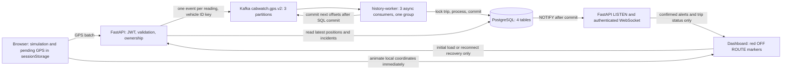

# CabWatch: Kafka fleet monitoring

A final-year project demonstrating Dijkstra route planning, asynchronous GPS processing,
off-route detection, durable consumer recovery and WebSocket dashboard updates.
It stores the latest processed position and incident history, not every GPS reading.

## Run

```sh
docker compose up -d --build
```

Open http://localhost:18080/cab-watch/, register, add a G-to-K trip and press Change
Route to simulate a detour. Return to Route retraces it. Existing installations must
follow [the backup and migration checklist](docs/KAFKA_DEPLOYMENT.md) before updating.

## Architecture: who does what?



FastAPI handles HTTP and WebSockets. It does not consume Kafka. The separate
`history-worker` process has three asynchronous consumer clients in the same
`cabwatch.gps.v2.journey-history-v1` group. Each owns one partition when all three
are healthy. Kafka reassigns partitions if a member disappears. These are three
async tasks, not three CPU processes. Run one worker service for this configuration.
The vehicle ID key keeps one vehicle's events on one partition.

The single local broker uses replication factor 1, persistent storage and seven-day
retention. This supports restart/buffering demonstrations, not high availability.
Producer idempotence and `acks=all` remain enabled. No Redis or additional application
topic is needed. Existing Kafka topics and consumer offsets are not recreated.

## Final database

Exactly four application tables; the complete [schema diagram and fields](docs/SCHEMA.md)
and executable [schema.sql](cab_watch/schema.sql) describe them.

| Table | Stored data |
|---|---|
| users | Account identity, password hash and JWT signing key |
| vehicles | Generated plate, owner, available/busy assignment |
| trips | Route, latest processed sequence/valid coordinates/capture time, durable off_route_count |
| alerts | Stable numeric incident ID, opening/closing GPS sequences, peak deviation and capture times |

No simulator motion, accepted checkpoint, GPS history JSON, derived history-state
JSON, processing timestamp, event UUID, close reason or historical flag is stored.
Trips and incidents are no longer automatically purged; preserve them and manage
backups as durable project records. Kafka still retains GPS events for seven days.

## GPS ingestion and Kafka event

`POST /cab-watch/me/trips` uses `Authorization: Bearer <JWT>` and a UUID
`Idempotency-Key` header with `{"pickup":"G","dropoff":"K"}`. The API locks the
user row, reuses an available vehicle or creates one, computes Dijkstra's route,
and inserts the trip in one transaction. New trips return 201; identical retries
return 200 with the same trip. Conflicting reuse of the key returns 409.

`POST /cab-watch/me/gps` accepts one reading per trip per batch (up to 1000):

```json
{"readings":[{"trip_id":"20000000-0000-4000-8000-000000000001","sequence":8,"captured_at":"2026-11-26T10:00:08Z","lat":13.095,"lon":80.205}]}
```

The browser always supplies an aware capture timestamp. For API compatibility,
omitting it uses server receipt time; timestamps more than two seconds ahead are
rejected. The request rejects `motion` and unknown reading fields.

A successful Kafka-mode request runs exactly two application SQL statements:
1. SELECT the JWT signing key.
2. SELECT owned trip IDs and vehicle IDs.

It does **zero PostgreSQL writes**. Admission control, ownership and timestamp checks
precede publishing. Each reading becomes one event. The API waits for broker ACKs,
then returns HTTP 202 (analysis may still be pending):

```json
{"mode":"kafka","queued":true,"results":[{"trip_id":"20000000-0000-4000-8000-000000000001","sequence":8,"queued":true,"applied":false}]}
```

Kafka key: `CB#001`. Value:

```json
{"trip_id":"20000000-0000-4000-8000-000000000001","user_id":"30000000-0000-4000-8000-000000000001","vehicle_id":"CB#001","sequence":8,"captured_at":"2026-11-26T10:00:08Z","lat":13.095,"lon":80.205}
```

No route or motion is published. Consumers still accept retained flat records with
those extra fields and older nested `point` envelopes; obsolete fields are ignored.
The route is always retrieved from the locked PostgreSQL trip row. A timeout or
503 can follow a partial Kafka publish: retry identical readings, never renumber.

## Consumer processing and recovery

`getmany` fetches up to 500 records across assigned partitions. For each returned
partition batch, the consumer groups trips, sorts each trip's readings by sequence,
and locks trips in deterministic ID order inside one SQL transaction. It verifies
user/vehicle ownership. Missing trips, completed trips and sequences at or below
`last_sequence` are skipped. There is no historical reconstruction.

For a newer sequence, calculate the minimum GPS-to-segment distance across the
planned route. At least 200 m is off route. Three consecutive off-route samples
confirm an incident. Sequences must be consecutive, timestamps must increase, and
capture gaps must be at most ten seconds. `off_route_count` is capped at three.

A sequence/time gap resets confirmation. An invalid or reversed capture timestamp
advances the deduplication sequence and resets the count, but preserves the last
valid position/time and any open incident. Thus `last_sequence` can identify a
rejected-time reading while the displayed coordinates retain their actual capture
time. A valid off-route reading after a gap starts at one. Gaps alone never close
an already open incident. Valid readings within 200 m resolve it.

| Reading | Deviation | Count | Action |
|---|---:|---:|---|
| 1 | 50 m | 0 | On route |
| 2 | 220 m | 1 | Confirming |
| 3 | 260 m | 2 | Confirming |
| 4 | 310 m | 3 | INSERT alert |
| 5 | 380 m | 3 | UPDATE peak on same alert ID |
| 6 | 240 m | 3 | Keep open |
| 7 | 100 m | 0 | UPDATE closing sequence/time |

Within one metre of the destination, the same transaction completes the trip,
resolves its open incident, resets the count and releases the vehicle. Later GPS
cannot reopen it. All incident times use capture times. No previous alert is
removed/recreated. A late sequence lower than the processed checkpoint is discarded;
this project deliberately does not recover missed historical GPS evidence.

The transaction updates GPS, count and incidents, issues `pg_notify` only if an alert opens, its peak changes, it closes, or the trip completes, then commits.
Only afterward does the consumer commit Kafka's **next offset**. SQL failure means
no offset commit. SQL success followed by offset-commit failure means replay, which
is harmless because `last_sequence` is already durable. Restarting a consumer also
retains a partially confirmed count (for example two of the required three).

## Dashboard and browser refresh

One sessionStorage value per signed-in user holds the pending upload batches and
local simulator snapshots: trip ID, coordinates, generated sequence, capture time,
mode, route index, detour trail/target and return path. A movement tick saves both
in **one storage write before upload**. Storage failure rolls back in-memory movement.
ACK removes pending readings without discarding the simulator checkpoint.

Refresh retries the original queued readings, restores the locally generated
sequence/motion, and waits for Start before moving again. The database's slower
processed sequence does not rewind the simulator. Change Route and Return to Route
are saved locally too. One browser/tab must be the simulator for a given trip;
copying a tab's session and running both is not supported.

Without local state, existing trips are **Display only**. The map still shows their
latest processed position and incidents, but Start and route controls cannot resume
them. Add a new trip to simulate. An unfinished trip may leave its vehicle busy if
its originating browser session is lost; no speculative cross-device recovery occurs.

The browser animates locally generated coordinates immediately after saving each
movement tick, without waiting for backend processing. The bounded pending-upload
queue still pauses generation if upload failures fill it, preventing silent data loss.
It never calculates or confirms off-route incidents. Local marker positions are labelled
as simulation; backend incident timestamps describe when confirmation occurred.

FastAPI listens for committed PostgreSQL notifications only on alert opening, peak
changes, resolution or trip completion. It reads authorized trip completion status,
open incidents and recent incident history in a consistent SQL snapshot. Messages
contain **no vehicle coordinates or per-reading GPS checkpoints**. Completed trips
are included explicitly, so completion cannot be confused with a missing vehicle.

The first WebSocket frame contains `{"token":"<JWT>"}`; JWT expiry is rechecked and
tokens never go in URLs. Initial/reconnect status snapshots are immediate. The server
rechecks status every five seconds to recover missed notifications, sending only
changed snapshots. The browser sends no periodic WebSocket position requests and
performs no continuous HTTP polling, including for incident history.

`GET /me/trips` is used on initial load/page refresh and once after a successful
WebSocket reconnection. Reconnection recovery never overwrites locally simulated
coordinates. Display-only vehicles retain their last loaded coordinates until a
page refresh or reconnection. Selecting a trip loads its full incident log once;
subsequent status snapshots merge recent incident changes into that log. Reconnection
also refreshes the selected incident log once. Red markers and badges reflect only
backend-confirmed open incidents; resolution clears them and completion stops local
movement. Backend messages never move local vehicle markers.

On disconnection the dashboard labels its confirmed status as stale and reconnects
automatically while local simulation continues. Kafka lag can still delay incident
confirmation. Snapshots may coalesce intermediate transitions; durable PostgreSQL
incident records retain them. No database migration is needed for this update.

## API inventory

- `POST /cab-watch/auth/register`, `POST /cab-watch/auth/login`: unchanged auth.
- `GET /cab-watch/network`: fictional road graph.
- `POST /cab-watch/me/trips`: create/idempotently retry a dispatch.
- `POST /cab-watch/me/gps`: upload GPS; Kafka mode returns 202.
- `GET /cab-watch/me/trips`: latest processed positions and recent incidents.
- `GET /cab-watch/me/trips/{trip_id}/alerts`: selected trip's full incident log.
- `POST /cab-watch/me/alerts/{numeric_id}/explain`: Gemini or evidence-based fallback.
- `WS /cab-watch/me/alerts/ws`: user-scoped alert/trip-status snapshot.
- `GET /healthz`: liveness, version `incremental-gps-v3`; not dependency readiness.
- `GET /cab-watch/metrics`: token-protected metrics from the API process only.

The full GPS-history endpoint/table/pagination are removed. Example trip response
(illustrative distances; actual route lengths come from the graph):

```json
{"id":"20000000-0000-4000-8000-000000000001","vehicle_id":"CB#001","origin":"G","destination":"K","route":["G","H","I","J","K"],"metres":4140,"completed":false,"last_sequence":0,"distance_m":0,"lat":null,"lon":null,"captured_at":null,"off_route_count":0}
```

Example incident in the selected-trip response:

```json
{"alerts":[{"id":42,"trip_id":"20000000-0000-4000-8000-000000000001","vehicle_id":"CB#001","opened_sequence":4,"closed_sequence":7,"peak_metres":380,"opened_at":"2026-11-26T10:00:04Z","resolved_at":"2026-11-26T10:00:07Z"}]}
```

`TELEMETRY_MODE=direct` remains a development-only fallback using the same incremental
processor. Stop the Kafka worker first; do not mix direct and Kafka writers.

## Tests and interview demo

```sh
python -m pip install -r requirements.txt
python -m unittest -v test_cab_watch test_retention test_telemetry test_live test_journey test_stream
node --test test_motion.mjs test_telemetry.mjs
```

CI additionally starts an isolated PostgreSQL/Kafka stack, runs migration, HTTP,
WebSocket, worker restart/outage and three-partition assignment tests, then runs
Playwright dashboard and refresh tests (including refresh while the real worker is
stopped). See [deployment/testing instructions](docs/KAFKA_DEPLOYMENT.md).

For the demo: stop `history-worker`, keep the browser running, observe HTTP 202 and
Kafka lag, then start the worker. Buffered readings update positions/incidents;
restarting again does not duplicate incidents. PostgreSQL must still be available
for authentication and ownership checks. Inspect group lag with:

```sh
docker compose exec kafka /opt/kafka/bin/kafka-consumer-groups.sh --bootstrap-server kafka:9092 --describe --group cabwatch.gps.v2.journey-history-v1
```

This is a bounded educational design, not a tested 10,000-vehicle deployment.
