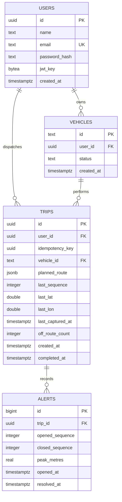

# Final four-table schema

Physical namespace: `cab_watch_accounts`. No new table is introduced.
`off_route_count` is the only added column. All timestamps are TIMESTAMPTZ.
Fields below are exhaustive; `?` means nullable.

| Table | Fields and types |
|---|---|
| users | id UUID PK; name TEXT; email TEXT UNIQUE; password_hash TEXT; jwt_key BYTEA; created_at TIMESTAMPTZ |
| vehicles | id TEXT PK (automatically generated CB# plate); user_id UUID FK; status TEXT available/busy; created_at TIMESTAMPTZ |
| trips | id UUID PK; user_id UUID FK; idempotency_key UUID; vehicle_id TEXT FK; planned_route JSONB; last_sequence INTEGER DEFAULT 0; last_lat DOUBLE PRECISION?; last_lon DOUBLE PRECISION?; last_captured_at TIMESTAMPTZ?; off_route_count INTEGER DEFAULT 0; created_at TIMESTAMPTZ; completed_at TIMESTAMPTZ? |
| alerts | id BIGINT identity PK; trip_id UUID FK; opened_sequence INTEGER; closed_sequence INTEGER?; peak_metres REAL; opened_at TIMESTAMPTZ; resolved_at TIMESTAMPTZ? |

Constraints preserved:
- `UNIQUE(trips.user_id, trips.idempotency_key)` for idempotent dispatch.
- Unique vehicle ID where `completed_at IS NULL`: one active trip per vehicle.
- Unique alert trip ID where `closed_sequence IS NULL`: one open incident per trip.
- `(trips.vehicle_id, trips.user_id)` references `(vehicles.id, vehicles.user_id)`.
- User foreign keys, alert-to-trip foreign key, route validation and plate generation.
- `off_route_count` is non-null and constrained to 0 through 3.

`alerts.id` never changes when peak or resolution changes. NULL closing sequence
means open. The consumer writes capture times, not notification/processing times.
No raw GPS-history table, simulator state, accepted checkpoint, event UUID or
additional status column exists. The old `motion`, `accepted_point`, `readings`,
`history_state`, `processed_at`, `event_key`, `close_reason`, `historical` columns
are dropped only by the documented transactional migration.
